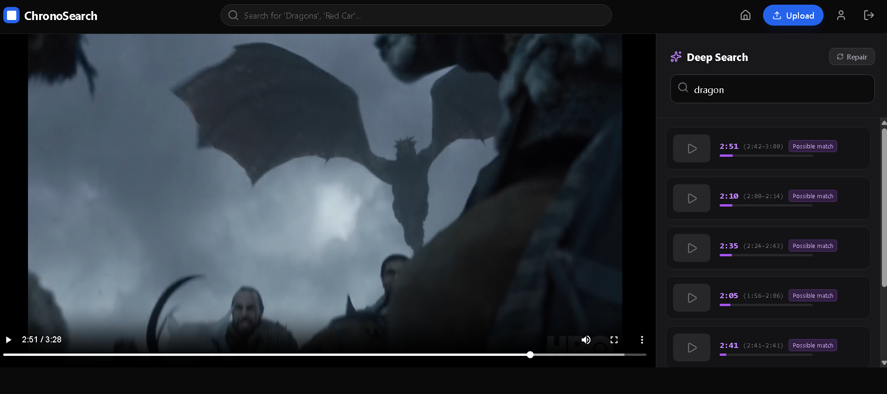
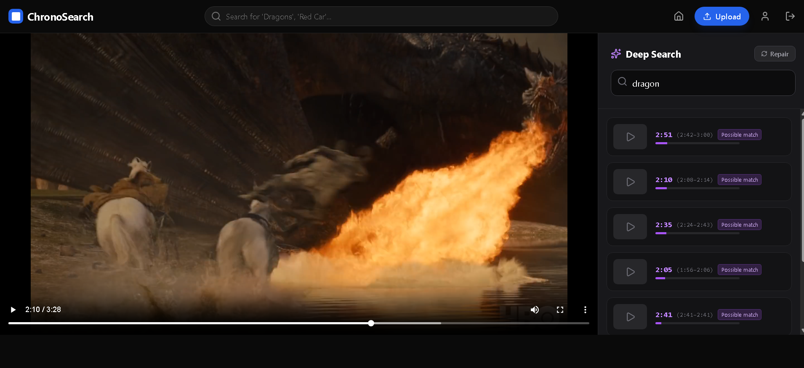
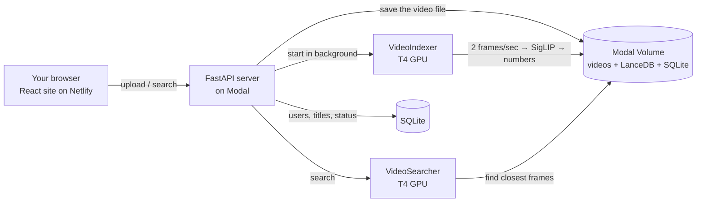

# ChronoSearch

**Search inside your videos by describing what you're looking for, and jump to that moment.**

### Live demo: [grand-biscochitos-1644ee.netlify.app](https://grand-biscochitos-1644ee.netlify.app)

> The first search after the app has been idle can take a minute or more. The server
> switches itself off when nobody is using it (to save money) and needs time to start again.

ChronoSearch is a working prototype. This README describes exactly what the code in this
repository does today, including what doesn't work yet (see [Known limitations](#known-limitations)).
Please don't upload private or sensitive videos to it.

---

## What it does

Normally, you can only search videos by their title or tags. If you want to find the part
where "a dog runs on the beach", you have to remember which video it was in and then drag
the slider back and forth until you find it.

ChronoSearch lets you type a description in plain English, like *"a dog running on the beach"*,
and it shows you which videos contain that and **at which second**. Click a result and the
video plays from that point.

It does this by having an AI model **look at the video frames** (the still pictures a video
is made of), not just read the title.




---

## Why this is hard

- **A video is thousands of pictures.** One minute of video is about 1,800 frames. Checking
  every single one would be slow and expensive, so ChronoSearch looks at only 2 per second.
- **Your search is words, but the video is pictures.** A normal search engine compares words
  with words. Here we need an AI model that can compare a sentence with a picture.
- **AI models need a GPU** (a graphics card that runs AI quickly). GPUs are expensive to keep
  running all day, so the app only switches one on when there's work to do.

---

## How it works, step by step

### When you upload a video

1. **The video is saved** on the server and added to a list of videos (a small SQLite database)
   with the status "processing".
2. **Frames are taken out.** The app saves about **2 pictures for every second** of video,
   shrunk to 640 pixels wide.
3. **Each picture becomes a list of numbers.** An AI model called **SigLIP** (made by Google)
   looks at each picture and turns it into a list of **1,152 numbers** that describes what's
   in it. This list is called an **embedding** (more on this below).
4. **The video's title and tags** also get turned into an embedding the same way.
5. **Everything is stored in LanceDB**, a database built for finding similar lists of numbers fast.
6. The video's status changes to **"completed"** (or **"failed"** if something went wrong).

### When you search

1. Your search text (for example *"red car at night"*) goes through the **same SigLIP model**
   and becomes a list of 1,152 numbers too.
2. LanceDB finds the stored frames whose numbers are **closest** to your search's numbers.
3. You get back those frames with their **time in the video** and a **confidence**: how likely
   SigLIP thinks each frame matches your text, from 0 to 1 (see
   [How the confidence is calculated](#how-the-confidence-is-calculated)).

### Key ideas in plain words

| Term | What it means |
|---|---|
| **Frame** | One still picture from a video. |
| **Embedding** | A list of numbers that describes the meaning of a picture or a sentence. Think of it as an address on a map of meanings: things that mean similar things have nearby addresses. |
| **SigLIP** | An AI model from Google that learned from millions of pictures with captions. Because of that, the picture of a red car and the text "red car" get similar numbers. This repo uses `google/siglip-so400m-patch14-384`. |
| **Cosine similarity** | A way to measure how close two embeddings are (the angle between them). Higher means more alike. |
| **Confidence** | SigLIP's own estimate, from 0 to 1, of how likely a frame matches your text. It is calculated from the cosine similarity with a formula SigLIP learned during training. |
| **Vector database (LanceDB)** | A database that is good at answering "which stored items are most similar to this one?" |
| **Modal** | A cloud service that runs our Python code on GPUs only when needed and shuts them down when idle. |
| **Cold start** | The wait while Modal starts a GPU machine after the app has been idle. |

---

## The two kinds of search

### 1. Search inside one video (on the video page)

You type a description while watching a video. The app:

- turns your text into an embedding,
- asks LanceDB for the **10 closest frames**, then keeps only the ones from this video,
- turns each frame's similarity into a **confidence** (below),
- shows each match with its **time** (click it to jump there) and a **confidence bar**.

What to expect:

- **The bar shows the confidence in %.** It is SigLIP's estimate that the frame matches your
  text. Results are sorted by confidence, highest first.
- **Good matches can still show a fairly low confidence** (for example 10–40%). SigLIP learned
  its confidence on its own training pictures, not on your videos, so compare results within
  one search rather than reading the number as an exact chance.
- **You may get fewer than 10 results, or none,** even when the video does contain the thing.
  That's because the app first picks the 10 closest frames from *all* videos and only then
  keeps the ones from your video. If other videos have closer matches, yours get pushed out.
  (See [Known limitations](#known-limitations).)
- **Times are rounded to whole seconds,** and may drift on some videos (explained below).

#### How the confidence is calculated

The code is in `backend/search.py` (`match_confidence`). It takes two steps.

**Step 1: cosine similarity.** LanceDB returns a cosine *distance* for each frame. The
similarity is:

```text
similarity = 1 − cosine_distance
```

**Step 2: turn the similarity into a confidence** with SigLIP's own learned numbers:

```text
confidence = sigmoid( exp(logit_scale) × similarity + logit_bias )

sigmoid(z) = 1 / (1 + e^(−z))
```

- `logit_scale` and `logit_bias` are two numbers the SigLIP model learned during training. The
  code reads them from the model (`model.logit_scale` and `model.logit_bias`). `logit_scale` is
  stored as a logarithm, which is why the formula uses `exp(logit_scale)`.
- **Why this works:** SigLIP was trained on pictures with captions. For every picture-caption
  pair, it had to answer "do these two belong together?" with a number between 0 and 1, using
  exactly this formula. So the formula gives SigLIP's own answer for your text and a frame.
- **`sigmoid`** squeezes any number into the range 0 to 1: large positive numbers become
  close to 1, large negative numbers close to 0, and 0 becomes 0.5.

An example with made-up round numbers (scale 100, bias −12; the real model has its own values):

| Similarity | 100 × similarity − 12 | Confidence |
|---|---|---|
| 0.15 | 3 | 0.95 |
| 0.12 | 0 | 0.50 |
| 0.10 | −2 | 0.12 |
| 0.05 | −7 | 0.001 |

A small difference in similarity becomes a clear difference in confidence.

**Why use the confidence and not just the similarity?** Both give the **same order** of results,
because a higher similarity always means a higher confidence. The confidence is better for
two other things:

- **It is easy to read.** "0.92" means "very likely a match". A similarity of "0.13" means
  nothing on its own.
- **It allows a cut-off.** `MIN_CONFIDENCE` in `backend/search.py` hides frames below a chosen
  confidence. It is `0.0` (off) by default; raise it (for example to 0.05 or 0.1) after
  trying some searches on your own videos.

Each search result from the API contains the `similarity`, the `confidence` (0 to 1) and the
`score` (the confidence × 100, used for the bar).

### 2. Search the whole library (search bar at the top)

You type a description on the home page. The app combines two searches:

- **Title and tags:** your text is compared with each video's title + tags embedding
  (the 20 closest are checked). Matches above a small threshold get a little bonus, because
  titles are a strong signal. These show as **"Title Match"**.
- **What's in the video:** your text is compared with frames from all videos
  (the 50 closest are checked, and frames with a similarity below 0.15 are skipped). The best
  frame of a video sets its score and time. These show as **"Visual Match"** with the time of
  that frame. Their title shows as "Untitled (Visual Match)", because this step doesn't look up
  the real title.
- **Visual matches also get a confidence,** with the same formula as above. The API returns it
  as `confidence` (0 to 1) and `confidence_display` (%); the home page doesn't show it yet.
  **Title matches keep using similarity:** the confidence formula was learned for *text and
  picture* pairs, and title search compares *text with text*, so a confidence there would not
  mean anything.
- **Each extra matching frame from the same video adds a small bonus (+0.05)** and adds
  "+ Visuals" to the label again. So a video that matched by title and in two frames shows as
  **"Title Match + Visuals + Visuals"**. The label is meant to appear once; this is a known bug.

Results are sorted by score, one result per video. The title search uses the same AI
model on the title text (it looks for similar meaning, not exact words). Library search runs
on the T4 GPU.

---

## Accounts, and public vs. private videos

- You can **create an account** with a username and password, or **sign in with Google**.
  Passwords are stored safely as bcrypt hashes (scrambled so they can't be read back).
- When you upload, you choose **public** or **private**.
- The **home feed** shows the latest 50 **public** videos.
- **Your profile** shows all your videos.
- Each video page has a **Repair** button that re-scans the video if search results look
  wrong. A video can be repaired at most once every 5 minutes.

Important: privacy is not fully enforced yet. Private videos can still appear in library
search, and anyone who has a video's link can watch it. See [Known limitations](#known-limitations).

---

## What you see in the app

| Page | What it does |
|---|---|
| **Login** | Log in, create an account, or sign in with Google. |
| **Home** | Latest public videos. Hover to preview. Type in the top search bar to search the whole library. |
| **Video page** | Plays the video. Search inside it and click a result to jump to that time. Shows "AI Processing Video..." until the video is ready (it checks every 5 seconds). Has the **Repair** button. |
| **Profile** | All your uploaded videos, marked public or private. |
| **Upload** (button in the top bar) | Choose a file, add a title, tags and public/private. |

---

## Tech stack

| Part | Technology |
|---|---|
| Website (frontend) | React 19, Vite 7, Tailwind CSS 3, React Router 7, Axios, Google sign-in button (`@react-oauth/google`) |
| Website hosting | Netlify |
| Server (backend) | Python, FastAPI |
| Cloud computing | Modal: T4 GPUs for indexing and search, a persistent disk ("Volume") for files |
| AI model | `google/siglip-so400m-patch14-384` (1,152 numbers per picture or sentence) |
| Vector database | LanceDB 0.5.7 |
| Video list and users | SQLite |
| Reading video frames | OpenCV |
| Login | bcrypt (passwords), JWT (login tokens), Google sign-in |

---

## How the parts connect



Every GPU machine shuts down after **5 minutes** with no work, so an idle app costs nothing.

---

## Project structure

```text
├── backend/
│   ├── main.py            # Starts the FastAPI app on Modal (deploy with: modal deploy -m backend.main)
│   ├── common.py          # Modal setup: app name, Python packages, the storage Volume
│   ├── api.py             # All the web routes: login, upload, search, stream, repair
│   ├── AI.py              # The GPU workers: VideoIndexer (upload) and VideoSearcher (search)
│   ├── extract.py         # Takes 2 frames per second out of a video (OpenCV)
│   ├── index.py           # Turns frames + title/tags into SigLIP numbers and saves them in LanceDB
│   ├── search.py          # Search inside one video, and the confidence formula (match_confidence)
│   ├── search_global.py   # Search the whole library (titles/tags + frames, with confidence for frames)
│   ├── database.py        # SQLite: users and videos (title, tags, public/private, status)
│   ├── auth.py            # Password hashing and login tokens
│   └── reset.py           # nuke_system: wipes the stored data (see note below)
├── frontend/
│   ├── src/
│   │   ├── pages/         # Home, VideoPlayer, Profile, Login
│   │   ├── components/    # Navbar, UploadModal
│   │   ├── services/api.js  # Talks to the backend
│   │   ├── App.jsx        # Page routes
│   │   └── main.jsx       # Starts the app, sets up Google sign-in
│   ├── public/
│   └── vite.config.js
├── ss1.png, ss2.png, ss3.png   # Screenshots
└── README.md
```

There are no automated tests yet.

---

## API endpoints

All routes start with `/api` on your Modal URL. FastAPI also shows interactive docs at `https://<your-url>/docs`.

| Method | Route | What it does |
|---|---|---|
| POST | `/api/register` | Create an account (`username`, `password`) |
| POST | `/api/login` | Log in. Returns a token, your user id and username |
| POST | `/api/google_login` | Log in with Google |
| POST | `/api/upload` | Upload a video (form fields: `file`, `user_id`, `title`, `tags`, `visibility`). Indexing starts in the background |
| GET | `/api/feed` | The latest 50 public videos |
| GET | `/api/my_videos?user_id=` | All videos of a user |
| GET | `/api/status?video_id=` | `processing`, `completed` or `failed` |
| GET | `/api/search?query=&video_id=` | Search inside one video. Each result has `timestamp`, `similarity`, `confidence` and `score` (confidence × 100) |
| GET | `/api/search_global?query=` | Search the whole library. Visual matches include `confidence` |
| GET | `/api/stream/{video_id}` | Play a video |
| POST | `/api/reindex?video_id=` | Repair: re-scan a video (once per 5 minutes per video) |
| GET | `/api/debug_files` | Lists all stored video files (for debugging; remove before real use) |

Video files are also served directly at `/data/videos/<video_id>.mp4`.

---

## Run it yourself

The commands use `python -m modal …`, which works on Windows, macOS and Linux even if the
`modal` command isn't on your PATH.

### What you need

- **Python 3.10 or newer** and **Node.js 20.19 or newer**
- A **[Modal](https://modal.com) account** with a payment method added (Modal requires one
  for T4 GPUs). There is no CPU-only mode in this version.

### 1. Get the code

```bash
git clone https://github.com/kishan705/Chronosearch_2.O.git
cd Chronosearch_2.O
```

### 2. Install the packages your computer needs to deploy

`modal deploy` loads the backend code on your computer before uploading it, so these must be installed locally:

```bash
python -m pip install modal fastapi python-multipart bcrypt "python-jose[cryptography]"
python -m modal setup          # log in to Modal in your browser
```

The AI packages (PyTorch, transformers, LanceDB, OpenCV) are installed on Modal's side, from the list in `backend/common.py`.

### 3. Before you deploy: change the secret key

Open `backend/auth.py` and replace the value of `SECRET_KEY` with a long random string.
This key signs login tokens. You can make one with:

```bash
python -c "import secrets; print(secrets.token_urlsafe(48))"
```

Don't commit your real key to a public repository.

### 4. Deploy the backend

```bash
python -m modal deploy -m backend.main
```

At the end, copy the URL printed next to `chrono_api`. It looks like:
`https://<your-modal-username>--chronosearch-v8-golden-chrono-api.modal.run`

Check it works: open `https://<your-url>/api/feed`. You should see `[]`.

The AI model is downloaded the first time a GPU machine needs it, so the **first upload and
first search are slow**.

### 5. Connect the website to your backend

Create a file called `frontend/.env` with your URL (no `/` at the end and no `/api`):

```text
VITE_API_URL=https://<your-url>.modal.run
VITE_GOOGLE_ID=<your Google OAuth client id>      # optional, only for the Google button
```

### 6. Run the website on your computer

```bash
cd frontend
npm install
npm run dev
```

Open `http://localhost:5173`, create an account and upload a short video. Vite only reads
`.env` when it starts, so restart `npm run dev` after you change it.

### 7. Put the website online with Netlify

First, create the file `frontend/public/_redirects` with this one line (it isn't in the repo
yet). Without it, opening a link like `/video/<id>` directly gives a "page not found" error on Netlify:

```text
/*  /index.html  200
```

Then:

```bash
cd frontend
npm run build                  # creates frontend/dist with your backend URL inside
```

1. Log in at [netlify.com](https://netlify.com) (sites added without an account are deleted).
2. Go to [app.netlify.com/drop](https://app.netlify.com/drop) and drag the **`frontend/dist`** folder onto it.
3. You get a `*.netlify.app` link. You can rename it under **Site configuration → Change site name**.

**Updating later**

- Website: `npm run build`, then drag the new `dist` folder onto your site's **Deploys** page.
- Backend: `python -m modal deploy -m backend.main`. Videos, accounts and the index are kept.

---

## Settings you can change

There is no settings file yet. These values are written directly in the code:

| What | Where | Current value |
|---|---|---|
| Frames saved per second | `backend/extract.py` | 2 |
| Frame width before the AI sees it | `backend/extract.py` | 640 pixels |
| AI model | `backend/index.py`, `search.py`, `search_global.py` | `google/siglip-so400m-patch14-384` |
| Results in "search inside a video" | `backend/search.py` | 10 closest frames |
| Library search: titles checked / minimum score / bonus | `backend/search_global.py` | 20 / 0.10 / ×1.2 |
| Library search: frames checked / minimum similarity | `backend/search_global.py` | 50 / 0.15 |
| Minimum confidence (search inside a video, and visual matches in library search) | `backend/search.py` (`MIN_CONFIDENCE`) | 0.0 (off) |
| GPU type, idle shutdown time | `backend/AI.py`, `backend/main.py` | T4, 5 minutes |
| Login token lifetime | `backend/auth.py` | 7 days |
| Repair cool-down | `backend/api.py` | 5 minutes |

If you change the frame rate or the model, re-upload or **Repair** your videos so their stored numbers match.

---

## Maintenance commands

```bash
python -m modal app logs chronosearch-v8-golden        # see live logs (uploads, errors)
python -m modal run -m backend.reset::nuke_system      # wipe stored data (read the note first)
```

**Note on `nuke_system`:** right now it only deletes the **video files**. The folder names it
uses for the search index (`/data/lancedb_store`) and the user/video database
(`/data/chronosearch.db`) are out of date: the real ones are `/data/lancedb_stable` and
`/data/metadata.db`. Update those two paths in `backend/reset.py` if you want a full reset.

To re-scan one video, use the **Repair** button on its page.

---

## Troubleshooting

| Problem | Likely cause | Fix |
|---|---|---|
| `'modal' is not recognized` | Modal isn't on your PATH | Use `python -m modal …` |
| `No module named 'bcrypt'` (or fastapi, jose) when deploying | Local packages missing | Step 2 |
| Deploy fails installing `lancedb==0.5.7` | That old version may not install on newer Python versions | Change the version in `backend/common.py` to a newer LanceDB, redeploy, and test search. Newer versions may print deprecation warnings |
| `Please add a payment method to use T4 GPU functions` | Modal needs a card for GPUs | Add a payment method in Modal |
| Website says it can't reach the backend | Wrong URL in `frontend/.env`, or backend not deployed | Open `https://<your-url>/api/feed`; check the Modal logs |
| Video stuck on "AI Processing" | Indexing failed or is still running | Check the logs; press **Repair** |
| "No frames found" in the logs | OpenCV can't read the video format (some iPhone `.mov` files) | Convert it: `ffmpeg -i in.mov -c:v libx264 -pix_fmt yuv420p out.mp4` |
| Search inside a video shows nothing | Other videos had closer matches (see below), the video isn't indexed yet, or `MIN_CONFIDENCE` is set too high | Try a more specific description; check the status; lower `MIN_CONFIDENCE` |
| Confidence bars look short even for good matches | Normal for SigLIP: its confidence wasn't tuned on your videos | Compare results within one search; see [How the confidence is calculated](#how-the-confidence-is-calculated) |
| `/video/<id>` link shows "page not found" on Netlify | `_redirects` file missing | Step 7 |
| First request takes a minute or more | Cold start: GPU machine starting and loading the model | Normal after a few idle minutes |

---

## Known limitations

This is a prototype. Here's what doesn't work well yet, in plain words.

### Search accuracy

- **Search inside a video can miss results.** It takes the 10 closest frames from *all*
  videos and then keeps only the ones from the current video, so it can return few or none.
- **Times are rounded down to whole seconds.** Two frames are taken each second, but both
  are saved with the same whole-second time.
- **Times can drift on some videos.** The app assumes each saved frame is exactly 0.5 seconds
  after the last one. That's true for 24, 30 and 60 frames-per-second videos. For 29.97 fps
  (very common), each step is really about 0.47 seconds, so after 10 minutes the time shown
  is about 40 seconds off. Phone videos with a changing frame rate can drift too.
- **The confidence isn't tuned on your videos.** It comes from what SigLIP learned on its own
  training pictures, so a good match can still show a low value. The cut-off
  (`MIN_CONFIDENCE`) is off by default, so you still get results when nothing really matches,
  until you raise it.
- **Neighbouring frames aren't grouped.** One scene can fill several results.
- **Library search scoring is uneven.** Every extra matching frame adds to a video's score and
  repeats "+ Visuals" in its label, so videos with many similar frames rank higher than they
  should. Videos found only by their frames show "Untitled (Visual Match)" instead of their title.
- **Tags aren't searchable right after upload.** Only the title is indexed at upload; tags are
  added when the video is repaired.
- **The AI model is reloaded on every search and upload**, which adds several seconds each time.
- **Wide videos get squashed.** SigLIP looks at square pictures, so small things at the edges
  of a 16:9 frame can be missed.
- **Speech and on-screen text aren't searched.** Only what's visible in the picture.

### Privacy and security (please read before using real videos)

- **The server doesn't check who you are.** The browser sends your user id with uploads and
  "my videos" requests, and the server trusts it. The login token is created but not checked
  by the server.
- **Google sign-in doesn't verify Google's token.** It reads the email from the token without
  checking Google's signature, so it could be faked. Fine for a demo, not for real users.
- **The secret key for login tokens is written in the code** (`backend/auth.py`). Change it
  before you deploy (step 3).
- **Private videos aren't fully private.** They can appear in library search, and anyone with a
  video's link (or the `/api/debug_files` list) can watch it.
- **Anyone can upload, and there's no size limit.** Every upload uses paid GPU time. Set a
  spending limit in Modal (**Usage & Billing → Workspace budget**).
- **No delete or "change to private" in the app yet.** The database has functions for both, but
  there are no buttons or routes for them.
- **Anyone can press Repair on any video** (with the 5-minute cool-down).

### Reliability

- **Two uploads at the same time can overwrite each other's search data.** Each upload copies
  the whole search index, adds its video, and copies it back, so the second one to finish can
  replace the first one's work. Use **Repair** if a video stops showing up in search.
- **`nuke_system` only deletes the video files** (see the note in Maintenance).
- **No automated tests.**

---

## Roadmap

Planned fixes, most important first:

- [ ] Check the login token on the server for every private action, and verify Google tokens properly
- [ ] Move the secret key into a Modal secret
- [ ] Keep private videos out of other people's search results and protect video links
- [ ] Filter by video *before* searching, so search inside a video always finds its own frames
- [ ] Use the real time of each frame from the video file, to the half second
- [ ] Load the AI model once per GPU machine instead of on every request
- [x] Run library search on the GPU
- [x] Show SigLIP's confidence for each visual match, with an optional minimum (`MIN_CONFIDENCE`)
- [ ] Check the confidence on a few labelled searches and choose a sensible minimum
- [ ] Group neighbouring frames into one "moment"
- [ ] Library search: count each video once and show its real title
- [ ] Index tags at upload time
- [ ] Use a single writer for the search index so uploads can't overwrite each other
- [ ] Delete and change-visibility buttons; upload size limits
- [ ] Search what's *said* (speech-to-text) and on-screen text
- [ ] A settings file and automated tests

---

## License

Open-source under the **MIT License**.

Built by [Kishan Amaliya](https://github.com/kishan705)
