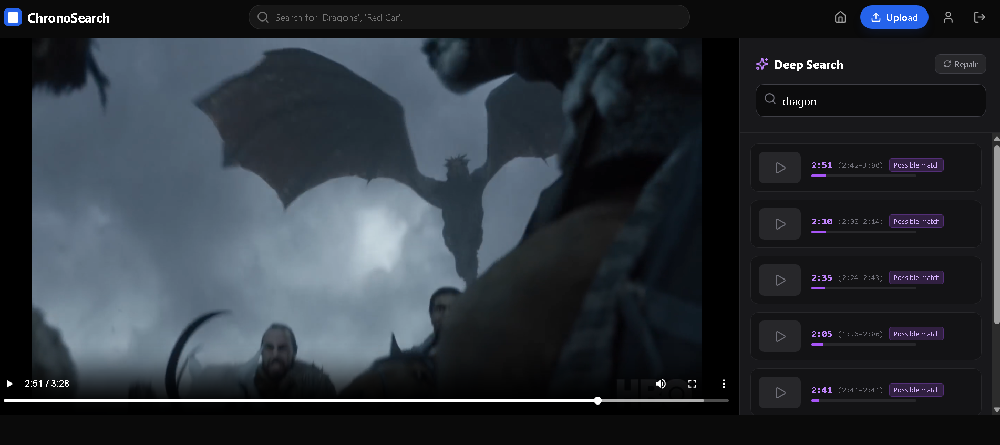
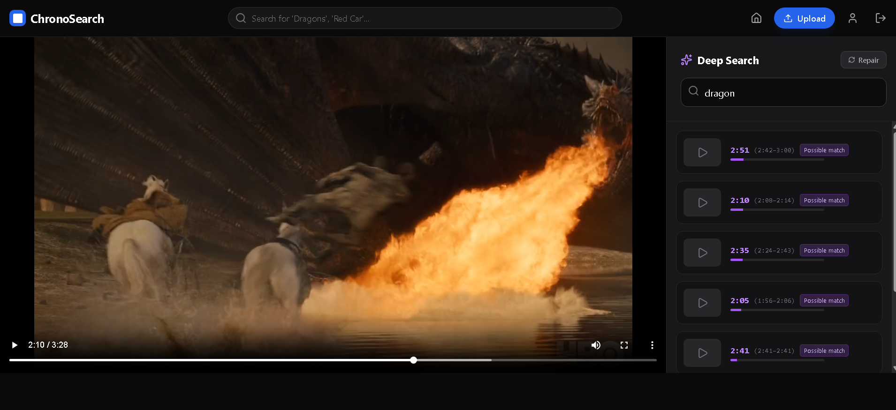
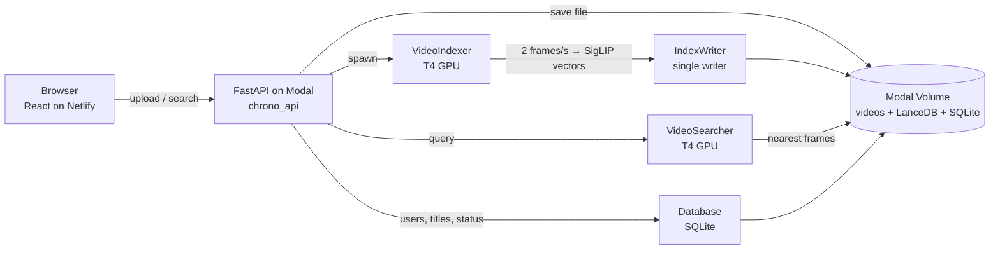

# ChronoSearch

**AI-powered semantic video search: find the exact moment, not just the file.**

> **Don't just search for videos. Search *inside* them.**

### 🔴 Live demo: [grand-biscochitos-1644ee.netlify.app](https://grand-biscochitos-1644ee.netlify.app)


ChronoSearch "watches" your videos. Every uploaded video is sampled twice per second, each
frame is turned into a vector by Google's **SigLIP** vision-language model, and those vectors
are stored in **LanceDB**. You can then type what you are looking for ("a man holding a
sword in the snow", "red car at night") and jump straight to the second it happens.

> The backend scales to zero when idle. The **first** request after a few idle minutes can take
> 30–60 seconds while a GPU container starts; after that, searches are fast.





---

## Two search engines in one app

### 1. Global search (top search bar)
* Searches your **whole library**: every public video plus your own private ones.
* Combines **keyword matching on titles and tags** (handles plurals, small typos and filler
  words like "show me") with **visual matching on every indexed frame**.
* One result per video, labelled **Title Match**, **Visual Match** or **Title + Visual Match**.
  Visual matches show the moment (e.g. *"at 3:20"*) and open the player right there.

### 2. Deep search (inside a video)
* Searches **one video** frame by frame.
* Returns distinct **moments** with a time range (e.g. `3:20 (3:20–3:22)`) and a confidence
  label: **Strong match**, **Possible match** or **Weak**.
* If nothing really matches, it says so instead of showing 10 random frames.

---

## Key features

* **Exact timestamps:** frame times come from the video decoder, so they are correct for
  23.976 / 25 / 29.97 fps and variable-frame-rate phone videos.
* **Calibrated confidence:** scores use SigLIP's own probability,
  `sigmoid(cosine × logit_scale + logit_bias)`, so "87%" actually means something.
* **Serverless GPU backend on Modal:** T4 GPUs start on demand; many uploads index in parallel.
* **Safe parallel uploads:** a single index writer means uploads can never overwrite each other's index.
* **Private videos stay private:** search only returns public videos and your own.
* **Repair button:** re-indexes a video if anything went wrong.
* **Auth:** username/password with bcrypt + JWT; Google sign-in is optional.
* **Video streaming** with seeking support.

---

## Tech stack

| Layer | Technology |
|---|---|
| Frontend | React 19, Vite 7, Tailwind CSS, Axios, React Router |
| Hosting (frontend) | Netlify |
| API | Python, FastAPI |
| Compute & storage | Modal (serverless T4 GPUs, persistent Volume, Secrets) |
| AI model | `google/siglip-so400m-patch14-384` on GPU, `google/siglip-base-patch16-224` in CPU mode |
| Vector database | LanceDB 0.24.2 |
| Metadata | SQLite (users, videos, status) on the Modal Volume |
| Video | OpenCV (frame sampling), ffmpeg |
| Auth | bcrypt, JWT (python-jose), Google OAuth (optional) |

---

## How it works



**Indexing (on upload)**
1. The API saves the video to the Modal Volume and records it in SQLite as `processing`.
2. `VideoIndexer` samples **2 frames per second** with OpenCV, keeping each frame's real timestamp.
3. Frames go through SigLIP in batches of 32 (fp16 on the T4) → 1152-dimensional vectors.
4. `IndexWriter` (one container at a time) replaces that video's rows in LanceDB.
5. Status becomes `completed` (or `failed`, which the Repair button can fix).

**Deep search**
1. The query is lower-cased and embedded together with the variant *"a photo of …"*.
2. LanceDB returns the 300 nearest frames **of that video only** (pre-filtered).
3. Hits within 3 s of each other are merged into one moment (max 20 s long).
4. Each moment gets a calibrated confidence; weak results far below the best one are dropped.

**Global search**
1. SQLite gives the videos you may see (public + your own, fully indexed).
2. Titles/tags get a keyword score; frames give the best visual match per video.
3. Both scores are on a 0–1 scale and merged into one ranking.

---

## API endpoints

All routes are under `/api` on your Modal URL. Interactive docs: `https://<your-url>/docs`.

| Method | Route | What it does |
|---|---|---|
| POST | `/api/register` | Create an account (username 3+ chars, password 6+) |
| POST | `/api/login` | Log in, returns a JWT |
| POST | `/api/google_login` | Log in with a verified Google ID token |
| POST | `/api/upload` | Upload a video (login required), starts indexing |
| GET | `/api/feed` | Latest public videos |
| GET | `/api/my_videos` | Your videos (login required) |
| GET | `/api/status?video_id=` | `processing` / `completed` / `failed` |
| GET | `/api/search?query=&video_id=` | Deep search inside one video |
| GET | `/api/search_global?query=` | Library search (titles, tags, frames) |
| GET | `/api/stream/{video_id}` | Stream a video |
| POST | `/api/reindex?video_id=` | Repair / re-index a video (5-minute cool-down) |

---

## Project structure

```text
├── backend/
│   ├── main.py             # Entry point: modal deploy -m backend.main
│   ├── api.py              # FastAPI routes
│   ├── AI.py               # Modal classes: VideoIndexer, IndexWriter, VideoSearcher
│   ├── auth.py             # bcrypt, JWT, Google token verification
│   ├── common.py           # Modal image, volume, secret, app
│   ├── config.py           # All settings: GPU/CPU switch, search tuning
│   ├── database.py         # SQLite (users, videos) – single container
│   ├── encoder.py          # SigLIP wrapper (loaded once per container)
│   ├── extract.py          # Frame sampling with real timestamps (OpenCV)
│   ├── index.py            # Embedding + LanceDB writes
│   ├── ranking.py          # Moments, confidence, keyword + visual merge
│   ├── search.py           # Deep search
│   ├── search_global.py    # Library-wide visual search
│   └── reset.py            # reindex_all / nuke_system
├── frontend/
│   ├── src/
│   │   ├── components/     # Navbar, UploadModal
│   │   ├── pages/          # Home, VideoPlayer, Profile, Login
│   │   ├── services/api.js # Axios client + backend URL
│   │   ├── App.jsx
│   │   └── main.jsx        # Entry point + error screen
│   ├── public/_redirects   # Netlify: send every route to index.html
│   ├── .env                # VITE_API_URL=<your Modal URL> (not committed)
│   └── vite.config.js
├── tests/
│   └── test_search_logic.py  # Timestamp + ranking tests (no GPU needed)
├── FIXES.md                # What was fixed in the search engine and why
└── README.md
```

---

## Run it yourself

The commands below use `python -m modal …`, which works on Windows, macOS and Linux even if
the `modal` command is not on your PATH.

### Prerequisites
* **Python 3.10+** (3.11 tested) and **Node.js 20.19+**
* A **[Modal](https://modal.com) account**. GPU functions need a payment method on the
  account; without one, use CPU mode (see [Configuration](#configuration)).
* **ffmpeg** (only for the tests and for making test videos)

### 1. Get the code
```bash
git clone https://github.com/kishan705/Chronosearch_2.O.git
cd Chronosearch_2.O
```

### 2. Install the local Python packages
`modal deploy` loads the backend on your computer before uploading it, so these must be installed locally:
```bash
python -m pip install modal fastapi python-multipart bcrypt "python-jose[cryptography]"
python -m modal setup          # log in to Modal in the browser
```

### 3. Create the login secret (once)
```bash
python -c "import secrets; print(secrets.token_urlsafe(48))"
python -m modal secret create chronosearch-secrets CHRONO_JWT_SECRET=<the string printed above>
```
To also enable Google sign-in, add `GOOGLE_CLIENT_ID=<your client id>` to that command.
To change a secret later, add `--force`. **Never commit or share the secret.**

### 4. Deploy the backend
```bash
python -m modal deploy -m backend.main
```
The first deploy takes 10–15 minutes (it downloads the model into the image). At the end,
copy the URL after `chrono_api =>`; it looks like
`https://<your-modal-username>--chronosearch-v8-golden-chrono-api.modal.run`.
Check it: `https://<your-url>/api/feed` should show `[]`.

### 5. Connect the frontend
Create `frontend/.env` with **your** URL (no `/` at the end, no `/api`):

```powershell
# Windows PowerShell
Set-Content -Path frontend\.env -Value "VITE_API_URL=https://<your-url>.modal.run" -Encoding ascii
```
```bash
# macOS / Linux
echo "VITE_API_URL=https://<your-url>.modal.run" > frontend/.env
```
Optional: add `VITE_GOOGLE_CLIENT_ID=<your client id>` on a second line for the Google button.

### 6. Run the frontend locally
```bash
cd frontend
npm install
npm run dev
```
Open `http://localhost:5173`, register and upload a video. Vite only reads `.env` when it
starts, so restart `npm run dev` after editing it.

### 7. Deploy the frontend to Netlify
```bash
cd frontend
npm run build                  # creates frontend/dist with your backend URL built in
```
1. Log in at [netlify.com](https://netlify.com) (sites dropped without an account are deleted).
2. Open [app.netlify.com/drop](https://app.netlify.com/drop) and drag the **`frontend/dist`** folder onto it.
3. You get a `*.netlify.app` link. Rename it under **Site configuration → Change site name**.

`frontend/public/_redirects` (`/*  /index.html  200`) is included in the build so links like
`/video/<id>` work when opened directly. If it's missing, create it before building.

**Updating later**
* Frontend: `npm run build`, then drag the new `dist` folder onto your site's **Deploys** page.
* Backend: `python -m modal deploy -m backend.main`. Videos, accounts and the index are kept.

---

## Configuration

Everything is in `backend/config.py`. After a change, redeploy the backend.

| Setting | Default | Meaning |
|---|---|---|
| `USE_GPU` | `True` | `True`: T4 GPU + large SigLIP model. `False`: CPU + small model (works without a card on Modal, less accurate). After switching, run `reindex_all`. |
| `SAMPLE_FPS` | `2.0` | Frames indexed per second of video (needs `reindex_all` after a change) |
| `MIN_CONFIDENCE` | `0.01` | Below this, a frame is not a match (deep search) |
| `STRONG_CONFIDENCE` | `0.30` | Above this, a moment is shown as "Strong match" |
| `RELATIVE_LOGIT_MARGIN` | `4.0` | Drops weak results far below the best one |
| `MOMENT_WINDOW_S` | `3.0` | Hits closer than this are one moment |
| `GLOBAL_MIN_VISUAL_CONFIDENCE` | `0.02` | Minimum confidence for a Visual Match in global search |
| `MIN_KEYWORD_SCORE` | `0.5` | Share of query words that must match a title/tags |

**Tuning tip:** every search result includes `cosine` and `confidence`. Open the browser's
DevTools → Network, run searches where you know the answer, and set the thresholds between
the scores of right and wrong results.

---

## Maintenance commands

```bash
python -m modal app logs chronosearch-v8-golden        # live logs (indexing, errors)
python -m modal run -m backend.reset::reindex_all      # re-index every video
python -m modal run -m backend.reset::nuke_system      # DELETE all videos, users and the index
python tests/test_search_logic.py                      # local tests (needs ffmpeg, opencv-python, numpy, pillow)
```

---

## Troubleshooting

| Problem | Cause | Fix |
|---|---|---|
| `'modal' is not recognized` | Modal's scripts folder is not on PATH | Use `python -m modal …` |
| `No module named 'bcrypt'` (or fastapi, jose) on deploy | Local packages missing | Step 2 of [Run it yourself](#run-it-yourself) |
| `Could not find a version that satisfies lancedb==0.5.7` | Old pin, no longer installable | Use the current `common.py` (LanceDB 0.24.2) |
| `Please add a payment method to use T4 GPU functions` | GPUs need a card on Modal | Add a card, or set `USE_GPU = False` |
| Deploy fails: secret `chronosearch-secrets` not found | Secret not created | Step 3 |
| `crash-looping` / `Function has 2 dependencies but container got 3` | A Modal object defined under a local-only condition | Keep `SECRETS = [modal.Secret.from_name("chronosearch-secrets")]` unconditional |
| Login page: "Backend URL missing" | `frontend/.env` empty or not loaded | Step 5, then restart `npm run dev` or rebuild |
| "Can't reach the backend" | Wrong URL, backend not deployed, or backend crashing | Open `/api/feed`; check the Modal logs |
| No `POST` lines in the Modal logs | Frontend talks to a different server | `.env` must contain **your** Modal URL |
| Video stuck on "AI Processing" | Indexing failed | Check logs for `❌ Indexing failed`; press **Repair** |
| `No frames could be decoded` | Codec OpenCV can't read (some HEVC .mov) | `ffmpeg -i in.mov -c:v libx264 -pix_fmt yuv420p out.mp4` |
| First search takes 30–60 s | Container cold start | Normal after a few idle minutes |

---

## Cost and safety

* Modal's Starter plan includes monthly free credits. Set a **Workspace budget** on
  Modal's **Usage & Billing** page so a public demo can never cost more than you expect.
* Anyone with the live link can register and upload, and every upload uses GPU time.
* Containers shut down after a few idle minutes, so an idle app costs nothing.

---

## Known limitations & roadmap

- [ ] **Speech search:** index Whisper transcripts so you can search what is *said*.
- [ ] **On-screen text:** OCR for slides, signs and subtitles.
- [ ] **Private streaming:** stream URLs are not access-controlled yet (signed, expiring URLs).
- [ ] **Upload limits:** file size/type limits and rate limiting.
- [ ] **Wide frames:** SigLIP squashes 16:9 frames to a square; extra crops would find small objects at the edges.
- [ ] **Synonyms in titles:** a sentence-embedding model for title/tag matching.
- [ ] **Scaling:** the index writer copies LanceDB on every write; fine for hundreds of videos, slow for thousands.

See [FIXES.md](FIXES.md) for the full list of search-engine bugs that were fixed (timestamp
drift, LanceDB post-filtering, lost index writes, broken global ranking) and why.

---

## License

Open-source under the **MIT License**.

Built with ❤️ by [Kishan Amaliya](https://github.com/kishan705)
